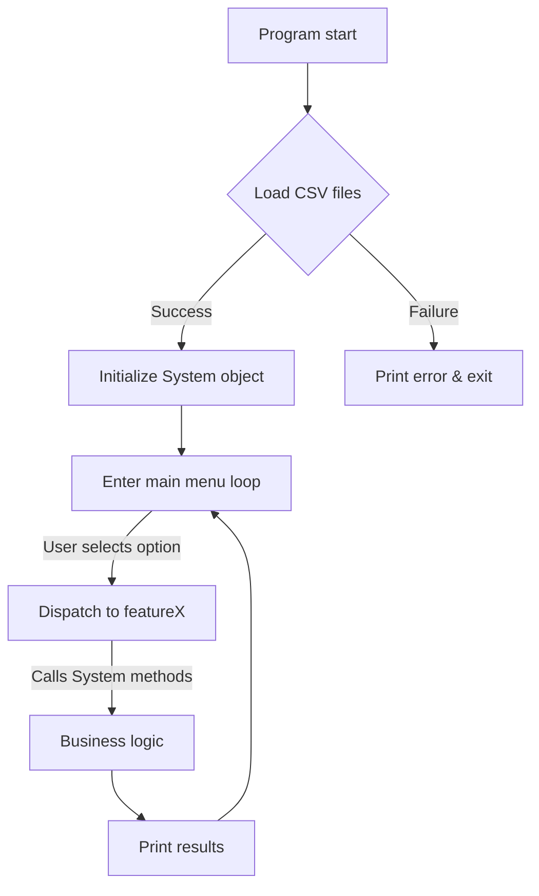

# College Bus Tracking System – Layer‑by‑Layer Explanation

---

## Table of Contents
1. [Project Overview](#project-overview)
2. [Documentation & Requirements](#documentation-requirements)
3. [Custom Data Structures](#custom-data-structures)
   - 3.1 `IntList`
   - 3.2 `IntStack`
   - 3.3 `IntQueue`
   - 3.4 `HashTable`
4. [Domain Models (`Models.*`)](#domain-models)
   - 4.1 Core structs (`Station`, `Bus`, `Recommendation`)
   - 4.2 `System` class – the heart of the app
   - 4.3 Helper utilities (parsing, time, string ops)
5. [CSV Loader (`CsvLoader.*`)](#csv-loader)
   - 5.1 File format expectations
   - 5.2 Loading pipeline
6. [User Interface (`main.cpp`)](#user-interface)
   - 6.1 Menu architecture
   - 6.2 Feature implementations (1‑5 fully functional)
   - 6.3 Stubs for future work (6‑12)
7. [Execution Flow Diagram](#execution-flow-diagram)
8. [Build & Run Instructions](#build-run)
9. [Design Decisions & Trade‑offs](#design-decisions)
10. [Potential Extensions](#extensions)
11. [Appendix – Full Code Listings (excerpt)](#appendix)
---

### <a name="project-overview"></a>1. Project Overview
The repository implements a **console‑based College Bus Tracking System**.  It reads static CSV files describing stations, buses, and routes, then offers an interactive terminal menu for:
- Searching stations (exact or prefix suggestions)
- Searching buses by number (binary search)
- Displaying a bus’s route and current status
- Building an arrival board per station
- Recommending the best bus to board at a station
- Clock manipulation (advance, set, undo)

The codebase deliberately **avoids the C++ Standard Library containers** (`std::vector`, `std::map`, …) to demonstrate hand‑crafted data structures that a beginner can understand.

---

### <a name="documentation-requirements"></a>2. Documentation & Requirements
File: **`College_Bus_Tracking_System__Team_ByteMe__-_PRD.md`**
- Gives a high‑level description, usage notes, and the assumed data folder layout (`data/`).
- Lists functional requirements (search, arrival board, recommendation) and non‑functional constraints (no STL, call‑by‑value). 
- Serves as the entry point for new developers.

---

### <a name="custom-data-structures"></a>3. Custom Data Structures
All containers live in **`DataStructures.{h,cpp}`** and are simple, fixed‑size, array‑based or singly‑linked implementations.

#### 3.1 `IntList`
- **Purpose:** Dynamically sized singly linked list of integers.
- **Key members:**
  ```cpp
  struct IntNode { int data; IntNode* next; };
  class IntList { IntNode* head; int count; ... };
  ```
- **Operations:** `pushBack`, `pushFront`, `contains`, `getAt`, `size`, `isEmpty`, `clear`.
- **Copy constructor:** Deep‑copies the list to honor the project rule “all functions use call‑by‑value”.

#### 3.2 `IntStack`
- **Purpose:** Fixed‑size LIFO stack for integers (size 500).
- **Implementation:** Simple array `items[500]` with an index `top`.
- **Operations:** `push`, `pop`, `peek`, `isEmpty`, `size`, `clear`.
- **Usage:** Stores bus IDs that serve a particular station (`sys.busesAtStation`).

#### 3.3 `IntQueue`
- **Purpose:** Circular queue for integers (also size 500).
- **Implementation details:**
  ```cpp
  int frontIndex, rearIndex, count;
  int items[500];
  ```
- **Operations:** `enqueue`, `dequeue`, `getFront`, `isEmpty`, `size`, `clear`.
- **Usage:** Building the *arrival board* – the queue holds bus IDs ordered by ETA.

#### 3.4 `HashTable`
- **Purpose:** Open‑addressing hash table mapping a **lower‑cased station name → station index**.
- **Table size:** 211 (prime number to reduce clustering).
- **Entry struct:**
  ```cpp
  struct HashEntry { std::string key; int value; bool isOccupied; };
  ```
- **Hash function:** Polynomial rolling hash (`sum = sum*31 + char`).
- **Collision resolution:** Linear probing.
- **Operations:** `insert`, `get`, `hashFunction`.
- **Why custom?** Guarantees deterministic performance without STL `unordered_map`.

---

### <a name="domain-models"></a>4. Domain Models (`Models.*`)
These files define the *business objects* and the central **`System`** class that coordinates everything.

#### 4.1 Core structs
| Struct | Fields | Meaning |
|--------|--------|---------|
| `Station` | `int id; string name; double lat, lon;` | Represents a bus stop. |
| `Bus` | `int busNo; string registration; char type; int capacity; int departure; int stopCount; int stops[100];` | One bus with its schedule and route. |
| `Recommendation` | `int bestBus; int secondBus; int eligibleCount;` | Result of `System::recommend`.

#### 4.2 `System` class (in `Models.h`)
```cpp
class System {
public:
    vector<Station> stations;      // loaded from stations.csv
    vector<Bus> buses;            // loaded from buses.csv
    vector<IntStack> busesAtStation; // one stack per station (bus IDs serving it)
    int now;                      // simulated time in minutes since midnight
    // … many helper methods …
};
```
*Key responsibilities*:
- **Lookup** – `findStation(string)`, `findBus(int)`. Station lookup uses the custom `HashTable`; bus lookup uses binary search on the sorted `buses` vector.
- **Suggestions** – `suggestStations` performs a linear scan for prefix matches when an exact name isn’t found.
- **Arrival board** – `buildArrivalBoard(int stationIdx)` creates an `IntQueue` ordered by ETA (earliest first). It iterates over `busesAtStation[stationIdx]`, computes ETA via `etaAt`, and enqueues accordingly.
- **Recommendation** – Chooses the bus with the smallest ETA that still has free seats.
- **Clock management** – `advanceClock`, `setClock`, `undoClock` (maintains a stack of previous timestamps for undo capability).
- **Utility helpers** – `parseInt`, `trimString`, `formatTime`, `statusName`, `seatStatus`.

#### 4.3 Helper utilities (non‑member functions)
- `toLowerCase(string)` – case‑insensitive handling for hash keys.
- `parseInt(string)` – safe conversion returning `-1` on failure.
- `formatTime(int minutes)` – converts minutes‑since‑midnight to `HH:MM` format.
- `statusName(int)` – maps enum values (`NOT_STARTED`, `RUNNING`, `REACHED`) to readable strings.

---

### <a name="csv-loader"></a>5. CSV Loader (`CsvLoader.*`)
Responsible for **deserializing** the three CSV files into the `System` object.

#### 5.1 Expected file format
| File | Columns (example) |
|------|-------------------|
| `stations.csv` | `id,name,lat,lon` |
| `buses.csv` | `busNo,registration,type,capacity,departure,stopCount,stop1,stop2,…` |
| `routes.csv` | *not directly used* – the route data is embedded in `buses.csv`.

#### 5.2 Loading pipeline (`bool loadAllData(const string& folder)`) 
1. **Open each CSV** using `ifstream`.  
2. **Parse line‑by‑line** – split on commas (`splitString`).  
3. **Create objects** (`Station`, `Bus`) and push them into `sys.stations` / `sys.buses`.  
4. **Populate `busesAtStation`** – for each bus, iterate its stops and push the bus index onto the corresponding station’s `IntStack`.  
5. **Initialize `HashTable`** – insert every station name (lower‑cased) with its index.  
6. Return `true` if all files opened and at least one record was loaded; otherwise `false`.

The loader is deliberately defensive – any malformed line aborts the load with an error message, preventing the rest of the program from running on incomplete data.

---

### <a name="user-interface"></a>6. User Interface (`main.cpp`)
Acts as the *presentation layer*; it never manipulates the data structures directly – all work is delegated to `System` methods.

#### 6.1 Menu architecture
```cpp
void printMenu();               // prints numbered options
int readNumber(string prompt); // reads an int with validation
string readLine(string prompt); // reads a line of text
```
The main loop is:
```cpp
while (running) {
    printMenu();
    int choice = readNumber("Choice: ");
    switch (choice) {
        case 1: featureSearchStation(); break;
        case 2: featureSearchBus();      break;
        // … cases 3‑12 …
        case 0: running = false; break;
    }
}
```
Each `feature*()` implements a single functional requirement.

#### 6.2 Fully implemented features (1‑5)
| Feature | Description | Core calls |
|---------|-------------|------------|
| **1. Search Station** | Exact lookup + prefix suggestions | `sys.findStation`, `sys.suggestStations` |
| **2. Search Bus** | Binary search, display status, upcoming stop, seat availability | `sys.findBus`, `sys.getStatus`, `sys.currentStopIndex`, `sys.seatsFree` |
| **3. Search Route** | Sub‑menu: (a) full route of a bus, (b) buses between two stations (stub) | `sys.buildArrivalBoard` for route view, stub for A→B |
| **4. Arrival Board** | Shows upcoming buses at a station ordered by ETA | `sys.buildArrivalBoard`, `sys.etaAt` |
| **5. Recommend a Bus** | Picks the earliest arriving bus with free seats | `sys.recommend` |

Each feature prints human‑readable tables using `iomanip` (`setw`, `left`).

#### 6.3 Stubs (features 6‑12)
Features such as *Shortest time (Dijkstra)*, *Fewest stops (BFS)*, *Connectivity (DFS)*, *Sorting demo*, *Dashboard*, *Save report* are present as placeholders that call `printNotReady`.  This makes the codebase ready for future expansion without breaking compilation.

---

### <a name="execution-flow-diagram"></a>7. Execution Flow Diagram

The diagram shows the high‑level cycle: **load → init → menu → feature → back**.

---

### <a name="build-run"></a>8. Build & Run Instructions
```bash
# From the project root (~/Downloads/PBL)
# Compile all .cpp files (no external libs required)
$ g++ *.cpp -o main
# Run with the default data folder (./data/)
$ ./main
# Or supply an explicit folder path
$ ./main /path/to/custom/data/
```
The program expects the CSV files inside the supplied folder.  If the folder does not contain `buses.csv`, it falls back to the current directory.

---

### <a name="design-decisions"></a>9. Design Decisions & Trade‑offs
| Decision | Rationale | Trade‑off |
|----------|-----------|----------|
| **No STL containers** | Pedagogical – demonstrates how basic containers work under the hood. | More boiler‑plate, fixed sizes (e.g., 500 element limit). |
| **Call‑by‑value everywhere** | Guarantees that objects are not accidentally mutated; aligns with the learning goal of understanding copying. | Slight performance overhead; deep copy needed for `IntList`. |
| **Separate CSV loader** | Keeps I/O isolated from business logic, simplifying testing. | Slight duplication of parsing logic across files. |
| **Fixed hash table size (211)** | Simplicity; a prime reduces clustering. | Not dynamically resizable – will overflow if many stations are added. |
| **Console UI only** | Keeps the project lightweight and portable. | No graphical interface; limited user experience. |

---

### <a name="extensions"></a>10. Potential Extensions
1. **Dynamic container resizing** – replace static arrays with dynamically allocated memory to remove the 500‑element cap.
2. **Graph algorithms** – implement Dijkstra, BFS, DFS for the route‑search features (currently stubs).
3. **Sorting demo** – complete the three sorting algorithms and allow the user to sort buses by different criteria.
4. **Dashboard UI** – a curses‑based or minimal Qt GUI to make the system more user‑friendly.
5. **Persistence** – write back any changes (e.g., clock adjustments) to a state file.
6. **Unit tests** – add a test suite (GoogleTest) covering each data structure and model method.

---

### <a name="appendix"></a>11. Appendix – Full Code Listings (excerpt)
Below are shortened snippets of the most important files.  The full source can be opened from the workspace.

#### `DataStructures.h`
```cpp
#ifndef DATASTRUCTURES_H
#define DATASTRUCTURES_H

#include <cstring>
using namespace std;

// Helper to convert a string to lowercase
string toLowerCase(string text);

// ---------- 1. Singly linked list ----------
struct IntNode { int data; IntNode* next; };
class IntList {
public:
    IntNode* head; int count;
    IntList(); ~IntList(); IntList(const IntList& other);
    void pushBack(int); void pushFront(int);
    bool contains(int); int getAt(int); int size(); bool isEmpty(); void clear();
};

// ---------- 2. Stack ----------
class IntStack { public: int items[500]; int top; IntStack(); void push(int); int pop(); int peek(); bool isEmpty(); int size(); void clear(); };

// ---------- 3. Queue ----------
class IntQueue { public: int items[500]; int frontIndex, rearIndex, count; IntQueue(); void enqueue(int); int dequeue(); int getFront(); bool isEmpty(); int size(); void clear(); };

// ---------- 4. Hash table ----------
struct HashEntry { string key; int value; bool isOccupied; };
class HashTable { public: HashEntry table[211]; HashTable(); int hashFunction(string); bool insert(string,int); int get(string); };

#endif // DATASTRUCTURES_H
```

#### `Models.h` (core part)
```cpp
#ifndef MODELS_H
#define MODELS_H

#include "DataStructures.h"
#include <vector>

struct Station { int id; string name; double lat, lon; };
struct Bus { int busNo; string registration; char type; int capacity; int departure; int stopCount; int stops[100]; };
struct Recommendation { int bestBus; int secondBus; int eligibleCount; };

class System {
public:
    vector<Station> stations;          // loaded from CSV
    vector<Bus> buses;                // loaded from CSV
    vector<IntStack> busesAtStation;  // one stack per station (bus IDs)
    HashTable stationLookup;          // name -> index
    int now;                          // simulated minutes since midnight
    // ----- lookup helpers -----
    int findStation(string name);          // exact (case‑insensitive) match
    int suggestStations(string prefix, int* out, int max);
    int findBus(int busNo);                // binary search
    // ----- runtime helpers -----
    int getStatus(int busIdx);
    int currentStopIndex(int busIdx);
    int etaAt(int busIdx, int stationIdx);
    IntQueue buildArrivalBoard(int stationIdx);
    Recommendation recommend(int stationIdx);
    // ----- clock -----
    void advanceClock(int minutes);
    void setClock(int minutes);
    bool undoClock();
    // ----- utility -----
    // ... (parseInt, trimString, formatTime, etc.)
};

bool loadAllData(const string& folder);

#endif // MODELS_H
```


---

